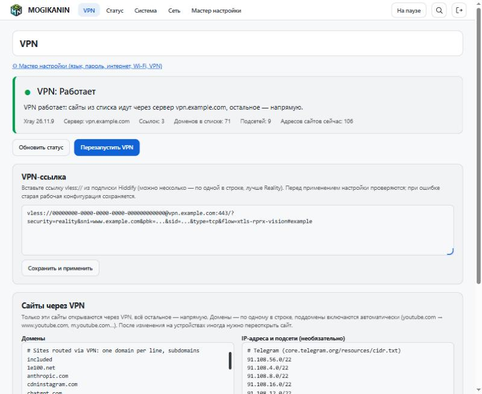
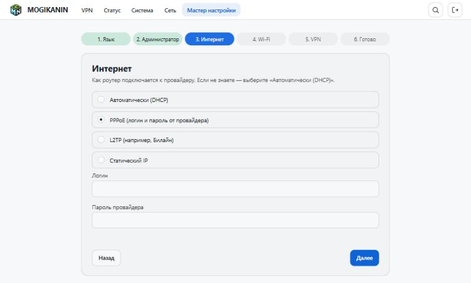

<p align="center"></p>

# MOGIKANIN — OpenWrt for Xiaomi AX3000T with selective VPN

[Русская версия](README.md) · [Download firmware (Releases)](../../releases/latest)

A ready-to-flash firmware based on **OpenWrt 25.12.6** for the **Xiaomi Mi Router AX3000T** (MediaTek MT7981). **Only the sites on a list** (YouTube, Instagram, Telegram, ChatGPT, …) go through the VPN; all other traffic goes directly through your ISP. The VPN is **Xray (VLESS + Reality)** to your own server (Hiddify, 3x-ui, Marzban, …).

For end users: after flashing, a **setup wizard** opens (language → password → internet → Wi-Fi → VPN link), and everything else is managed on a single "VPN" page.

> ⚠️ Flashing a router is always a risk. Proceed at your own risk and double-check the model (see "Supported hardware").

---

## Features

| | |
|---|---|
| **Selective VPN** | Only listed sites (including subdomains) use the VPN, everything else goes direct. The list is editable in the web UI. |
| **Xray VLESS + Reality** | TCP/Vision and XHTTP transports. Several links → the fastest server is chosen automatically, XHTTP is the fallback. |
| **"VPN" page** | Plain-language status (🟢 working / 🟠 no connection to server / 🔴 not running / ⚪ not configured) with the reason and errors, internet check, `vless://` links, domain and subnet lists, restart. Links are validated before applying — a bad link never breaks a working setup. |
| **Setup wizard** | Language (RU/EN), admin password, internet (DHCP / PPPoE / L2TP / static IP), Wi-Fi (WPA2/WPA3, WPA3, WPA2 or open with a warning), VPN link, "internet works / VPN works" check. Opens automatically after a reset. |
| **Tamper-proof DNS** | Listed domains are resolved through the VPN tunnel (the ISP cannot spoof answers). All clients' DNS is forced through the router, DNS-over-TLS (port 853) is blocked. |
| **Security** | Router access (web and SSH) only from the home network; SSH keys only; no UPnP; IPv6 disabled (so traffic can't bypass the VPN); Wi-Fi off until configured. |
| **Footstrap theme** | Modern light/dark LuCI, phone-friendly. |
| **No secrets inside** | The image contains no passwords and no VPN links — everything is entered in the wizard. |

### Screenshots

| "VPN" page | Setup wizard |
|---|---|
|  |  |

---

## Supported hardware

| Item | Value |
|---|---|
| Model | **Xiaomi Mi Router AX3000T**, revisions **RD03** (China) and **RD23** (Global) |
| SoC | MediaTek **MT7981B** (Filogic 820), 2 × Cortex-A53 1.3 GHz |
| Memory | 256 MB RAM, 128 MB NAND (ESMT / Winbond / Foresee) |
| Switch | MediaTek MT7531AE **or** Airoha AN8855 — both supported |
| Wi-Fi | MediaTek MT7976C, 2.4 + 5 GHz, Wi-Fi 6 (AX3000) |
| Ports | 1 WAN + 3 LAN, 1 Gbit/s |
| Flash layout | **stock** (OpenWrt profile `xiaomi_mi-router-ax3000t`) |

**Not supported:**
- ❌ **AX3000T "RD03v2"** — a new revision on Qualcomm **IPQ5018** (entirely different hardware). Signs: "RD03v2"/"v2" on the label, stock firmware **2.x**.
- ❌ Routers already running OpenWrt with the modified bootloader (**ubootmod**, profile `xiaomi_mi-router-ax3000t-ubootmod`) — needs a separate build (see "Building").
- ❌ Other Xiaomi models (AX3000T ≠ AX3000 / AX3200 / CR8806, etc.).

On a router running OpenWrt: `cat /tmp/sysinfo/board_name` must print `xiaomi,mi-router-ax3000t` (without `-ubootmod`).

---

## Installation

Files are in [Releases](../../releases):
- `MOGIKANIN-…-sysupgrade.bin` — the firmware;
- `SHA256SUMS` — checksums (verify the file before flashing).

### Option A. The router already runs OpenWrt (stock layout)

1. Open the OpenWrt web UI → **System → Backup / Flash Firmware**.
2. "**Flash image…**" → choose `MOGIKANIN-…-sysupgrade.bin`.
3. **Uncheck** "Keep settings" → "Continue".
4. Wait 3–4 minutes, **do not power off**.
5. Continue with "First start".

### Option B. A new router with Xiaomi stock firmware

First install official OpenWrt (temporary `initramfs-factory.ubi` image), then this firmware.

1. Connect the PC to a **LAN port** with a cable (the router doesn't need internet). Complete the Xiaomi initial setup at http://192.168.31.1 and set a password — you'll need it.
2. Check the stock firmware version (in the Xiaomi web UI). If it is **newer than 1.0.84** and the next step reports `Exploits … not working`, first **downgrade the stock firmware to 1.0.76** with **MIWIFIRepairTool** (Xiaomi's official recovery tool).
3. Download **[XMiR-Patcher](https://github.com/openwrt-xiaomi/xmir-patcher)** and unpack it.
4. Download the official **`openwrt-25.12.6-mediatek-filogic-xiaomi_mi-router-ax3000t-initramfs-factory.ubi`** from [downloads.openwrt.org](https://downloads.openwrt.org/releases/25.12.6/targets/mediatek/filogic/) into XMiR-Patcher's `firmware` folder.
5. Run `!START.bat` (Windows) or `run.sh` (Linux/macOS):
   - **2** — Connect to device (install exploit), enter the Xiaomi web password;
   - **7** — Install firmware (from directory "firmware"), wait until the connection drops.
6. After 1–2 minutes the router boots the temporary OpenWrt: http://**192.168.1.1**, login `root`, empty password.
7. Flash this firmware as in **Option A** (uncheck "Keep settings").

Official detailed guide (including the manual SSH method and recovery): [openwrt.org/toh/xiaomi/ax3000t](https://openwrt.org/toh/xiaomi/ax3000t).

### First start

1. Connect to the router **by cable** (Wi-Fi is off until configured).
2. Open **http://192.168.31.1**, login `root`, **empty** password.
3. The **setup wizard** opens:
   1. language;
   2. administrator password (required, 6+ characters; login is always `root`);
   3. internet: DHCP / PPPoE / L2TP / static IP — as your ISP requires;
   4. Wi-Fi: network name and security (WPA2/WPA3 recommended, password 8+ characters);
   5. VPN link `vless://…` from your server's subscription (can be skipped and added later);
   6. "Apply" → after ~30 s the wizard shows: internet works / VPN works.
4. If you changed Wi-Fi, reconnect to the new network.

---

## Usage

After login the **VPN** page opens:
- **Status** — whether the VPN works and, if not, why (no link, no connection to the server, service not running) + recent errors.
- **VPN link** — paste one or more `vless://` links (one per line) → "Save and apply".
- **Sites via VPN** — domains, one per line (subdomains included automatically: `youtube.com` → `www.youtube.com`, `m.youtube.com`, …) and IP subnets → "Save list". Devices may need to reopen a site after a change.
- **Setup wizard** — available from the menu at any time.

Supported links: `vless://` with `security=reality` or `tls`, transport `tcp`/`raw` (preferably `flow=xtls-rprx-vision`) or `xhttp`.

### Reset and backup
- **Factory reset** (hold Reset on the running router for more than 5 seconds, or "System → Backup → Reset"): the firmware stays, the router starts from scratch and opens the wizard again.
- **Backup**: "System → Backup → Generate archive" — saves all settings including VPN links and the site list. ⚠️ The archive contains passwords — keep it safe.
- **SSH** (port 10122, home network only, keys only): add your key in "System → Administration → SSH-Keys".

### Limitations
- Devices with their own encrypted DNS (browser "Secure DNS", Android "Private DNS" with DoH) bypass the router DNS — listed sites may go direct for them. Disable these features on the devices.
- Routing is by IP: a site **not** on the list that shares an IP with a listed one (CDNs: Google, Cloudflare) also goes through the VPN.
- IPv6 is disabled on purpose.
- You need **your own** VLESS Reality server — the firmware does not provide one.

---

## Changes compared to OpenWrt 25.12.6

| Change | Files |
|---|---|
| Packages: LuCI (RU), Footstrap theme, `dnsmasq-full` (nftset), `xray-core`, `kmod-tun`, `xl2tpd` | `build/build.sh` |
| Xray **26.11.9** (official XTLS release) instead of the packaged one — the packaged version's Reality fails with some ISPs | `/usr/bin/xray` |
| Selective VPN: Xray TUN interface `xray0`, mark 0x100 → table 100 | `files/etc/nftables.d/20-xray-mark.nft`, `files/etc/uci-defaults/99-mogikanin` |
| Xray config generator from links, list apply, status | `files/usr/bin/xvpn` |
| Setup wizard (backend) | `files/usr/bin/xvpn-wizard` |
| "VPN" and "Setup wizard" web pages (LuCI JS + rpcd) | `files/www/luci-static/resources/view/xvpn/`, `files/usr/libexec/rpcd/xvpn`, `files/usr/share/{luci/menu.d,rpcd/acl.d}/` |
| First-boot defaults: LAN 192.168.31.1, IPv6 off, `vpn` firewall zone, forced DNS, DoT block, SSH 10122 LAN-only with keys, web UI closed from WAN, Wi-Fi off until a password is set | `files/etc/uci-defaults/99-mogikanin` |
| Default site list | `files/etc/xray/domains.txt`, `files/etc/xray/subnets.txt` |
| Logo in the UI (Footstrap theme) | `files/www/luci-static/footstrap/` |

## Tested

On a Xiaomi AX3000T (Foresee NAND, AN8855 switch), OpenWrt 25.12.6, November 2026:
- clean install (settings not kept): the router comes up at 192.168.31.1, serves DHCP and opens the wizard;
- wizard: language, password, DHCP, Wi-Fi WPA2/WPA3, VPN links → internet and VPN work;
- VPN over Reality TCP/Vision: 30 of 30 requests to listed sites go through the VPN, other sites go direct;
- firmware upgrade with settings kept.

Not tested: PPPoE, L2TP and static IP in the wizard (they use standard OpenWrt protocols), the MT7531 switch and other stock-firmware revisions.

## Building

On Linux x86_64 (≈2 GB free):
```bash
git clone <this repository> && cd <folder>
./build/build.sh
```
The script downloads the official OpenWrt 25.12.6 ImageBuilder and Xray 26.11.9, verifies their checksums and builds the image into `.build/ib/bin/targets/mediatek/filogic/`. For a ubootmod router change `PROFILE` to `xiaomi_mi-router-ax3000t-ubootmod`.

## Licenses

- Scripts and web pages in this repository — [MIT](LICENSE).
- OpenWrt — GPL-2.0 and others; source: [github.com/openwrt/openwrt](https://github.com/openwrt/openwrt) (tag `v25.12.6`), [openwrt/luci](https://github.com/openwrt/luci), [openwrt/packages](https://github.com/openwrt/packages).
- Xray-core — MPL-2.0; source: [github.com/XTLS/Xray-core](https://github.com/XTLS/Xray-core) (tag `v26.11.9`).

See [NOTICE](NOTICE). This project is not affiliated with Xiaomi, OpenWrt or XTLS.
