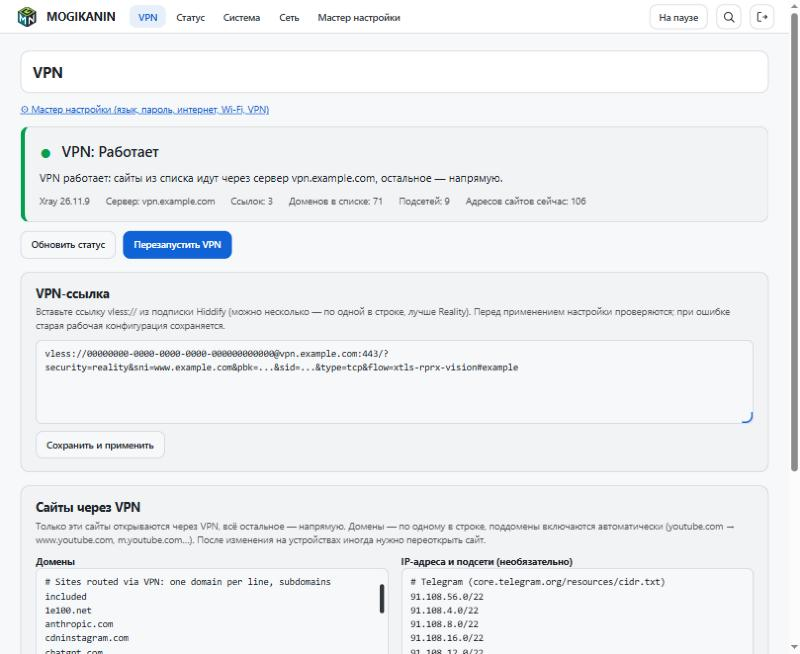
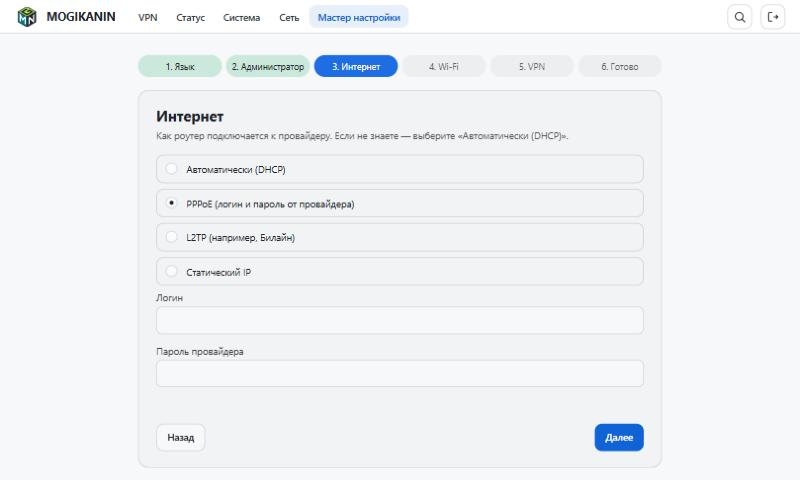

<p align="center"></p>

# MOGIKANIN — OpenWrt для Xiaomi AX3000T с выборочным VPN

[English version](README.en.md) · [Скачать прошивку](firmware/)

Готовая прошивка на базе **OpenWrt 25.12.6** для роутера **Xiaomi Mi Router AX3000T** (MediaTek MT7981). Через VPN идут **только сайты из списка** (YouTube, Instagram, Telegram, ChatGPT и т. п.), весь остальной трафик — напрямую через провайдера. VPN — **Xray (VLESS + Reality)** до вашего собственного сервера (Hiddify, 3x-ui, Marzban и др.).

Для обычного пользователя: после прошивки открывается **мастер настройки** (язык → пароль → интернет → Wi-Fi → VPN-ссылка), а дальше всё управление — на одной странице «VPN».

> ⚠️ Прошивка роутера — всегда риск. Делайте всё на свой страх и риск, внимательно проверьте модель (раздел «Для какого роутера»).

---

## Возможности

| | |
|---|---|
| **Выборочный VPN** | Только сайты из списка идут через VPN (с поддоменами), остальное — напрямую. Список правится в веб-интерфейсе. |
| **Xray VLESS + Reality** | Транспорты TCP/Vision и XHTTP. Несколько ссылок → автоматический выбор самого быстрого сервера, запасной канал — XHTTP. |
| **Страница «VPN»** | Статус понятными словами (🟢 работает / 🟠 нет связи с сервером / 🔴 не запущен / ⚪ не настроен) с причиной и ошибками, проверка интернета, вставка ссылок `vless://`, списки доменов и подсетей, перезапуск. Ссылки проверяются перед применением — неверная ссылка не ломает рабочую настройку. |
| **Мастер настройки** | Язык (RU/EN), пароль администратора, интернет (DHCP / PPPoE / L2TP / статический IP), Wi-Fi (WPA2/WPA3, WPA3, WPA2 или открытая сеть с предупреждением), VPN-ссылка, проверка «интернет есть / VPN работает». Открывается сам после сброса. |
| **DNS без подмены** | Домены из списка разрешаются через VPN-туннель (провайдер не может подменить ответ). DNS всех устройств принудительно идёт через роутер, DNS-over-TLS (порт 853) закрыт. |
| **Безопасность** | Доступ к роутеру (веб и SSH) — только из домашней сети; SSH — только по ключу; UPnP нет; IPv6 выключен (чтобы трафик не уходил мимо VPN); Wi-Fi до настройки выключен. |
| **Тема Footstrap** | Современный светлый/тёмный интерфейс LuCI, удобно с телефона. |
| **Без паролей внутри** | В прошивке нет ни паролей, ни VPN-ссылок — всё вводится в мастере. |

### Скриншоты

| Страница «VPN» | Мастер настройки |
|---|---|
|  |  |

---

## Для какого роутера

| Параметр | Значение |
|---|---|
| Модель | **Xiaomi Mi Router AX3000T**, ревизии **RD03** (Китай) и **RD23** (Global) |
| Процессор | MediaTek **MT7981B** (Filogic 820), 2 × Cortex-A53 1,3 ГГц |
| Память | 256 МБ ОЗУ, 128 МБ NAND (ESMT / Winbond / Foresee) |
| Коммутатор | MediaTek MT7531AE **или** Airoha AN8855 — поддерживаются оба |
| Wi-Fi | MediaTek MT7976C, 2,4 + 5 ГГц, Wi-Fi 6 (AX3000) |
| Порты | 1 WAN + 3 LAN, 1 Гбит/с |
| Разметка флеш-памяти | **стоковая** (OpenWrt-профиль `xiaomi_mi-router-ax3000t`) |

**Не подходит:**
- ❌ **AX3000T «RD03v2»** — новая ревизия на Qualcomm **IPQ5018** (другое железо целиком). Признаки: на наклейке «RD03v2»/«v2», заводская прошивка версии **2.x**.
- ❌ Роутеры, где уже стоит OpenWrt с модифицированным загрузчиком (**ubootmod**, профиль `xiaomi_mi-router-ax3000t-ubootmod`) — нужна отдельная сборка (см. «Сборка»).
- ❌ Другие модели Xiaomi (AX3000T ≠ AX3000 / AX3200 / CR8806 и т. д.).

Проверить на роутере с OpenWrt: `cat /tmp/sysinfo/board_name` → должно быть `xiaomi,mi-router-ax3000t` (без `-ubootmod`).

---

## Установка

Файлы — в папке [firmware/](firmware/) (и в [Releases](../../releases), если опубликован):
- `MOGIKANIN-…-sysupgrade.bin` — прошивка;
- `SHA256SUMS` — контрольные суммы (проверьте файл перед прошивкой).

### Вариант А. На роутере уже стоит OpenWrt (стоковая разметка)

1. Откройте веб-интерфейс OpenWrt → **Система → Резервное копирование / Прошивка**.
2. «**Прошить образ…**» → выберите `MOGIKANIN-…-sysupgrade.bin`.
3. **Снимите** галочку «Сохранить настройки» → «Продолжить».
4. Подождите 3–4 минуты, **не выключайте питание**.
5. Дальше — «Первый запуск».

### Вариант Б. Новый роутер с заводской прошивкой Xiaomi

Сначала ставится официальный OpenWrt (временный образ `initramfs-factory.ubi`), затем — наша прошивка.

1. Подключите ПК к **LAN-порту** роутера кабелем, интернет к роутеру можно не подключать. Пройдите начальную настройку Xiaomi в браузере (http://192.168.31.1), задайте пароль — он понадобится.
2. Узнайте версию заводской прошивки (в веб-интерфейсе Xiaomi). Если она **новее 1.0.84** и следующий шаг сообщает, что уязвимости не работают (`Exploits … not working`), сначала **откатите заводскую прошивку на 1.0.76** утилитой **MIWIFIRepairTool** (официальная утилита восстановления Xiaomi).
3. Скачайте **[XMiR-Patcher](https://github.com/openwrt-xiaomi/xmir-patcher)** и распакуйте.
4. Скачайте официальный образ **`openwrt-25.12.6-mediatek-filogic-xiaomi_mi-router-ax3000t-initramfs-factory.ubi`** с [downloads.openwrt.org](https://downloads.openwrt.org/releases/25.12.6/targets/mediatek/filogic/) и положите в папку `firmware` XMiR-Patcher.
5. Запустите `!START.bat` (Windows) или `run.sh` (Linux/macOS):
   - **2** — Connect to device (install exploit), введите пароль от веб-интерфейса Xiaomi;
   - **7** — Install firmware (from directory "firmware"), дождитесь разрыва соединения.
6. Через 1–2 минуты роутер загрузится во временный OpenWrt: http://**192.168.1.1**, логин `root`, пароль пустой.
7. Прошейте нашу прошивку как в **варианте А** (галочку «Сохранить настройки» снять).

Подробная официальная инструкция (в т. ч. ручной способ через SSH и восстановление): [openwrt.org/toh/xiaomi/ax3000t](https://openwrt.org/toh/xiaomi/ax3000t).

### Первый запуск

1. Подключитесь к роутеру **кабелем** (Wi-Fi до настройки выключен).
2. Откройте **http://192.168.31.1**, логин `root`, пароль — **пустой**.
3. Откроется **мастер настройки**:
   1. язык;
   2. пароль администратора (обязательно, от 6 символов; логин всегда `root`);
   3. интернет: DHCP / PPPoE / L2TP / статический IP — как требует провайдер;
   4. Wi-Fi: имя сети и защита (рекомендуется WPA2/WPA3, пароль от 8 символов);
   5. VPN-ссылка `vless://…` из подписки вашего сервера (можно пропустить и добавить позже);
   6. «Применить» → через ~30 секунд мастер покажет: интернет есть / VPN работает.
4. Если меняли Wi-Fi, подключитесь к новой сети.

---

## Пользование

После входа сразу открывается страница **VPN**:
- **Статус** — работает ли VPN, и если нет — почему (нет ссылки, нет связи с сервером, служба не запущена) + последние ошибки.
- **VPN-ссылка** — вставьте одну или несколько ссылок `vless://` (по одной в строке) → «Сохранить и применить».
- **Сайты через VPN** — домены по одному в строке (поддомены включаются сами: `youtube.com` → `www.youtube.com`, `m.youtube.com`…) и IP-подсети → «Сохранить список». После изменения на устройстве иногда нужно переоткрыть сайт.
- **Мастер настройки** — доступен в меню в любой момент.

Поддерживаемые ссылки: `vless://` с `security=reality` или `tls`, транспорт `tcp`/`raw` (лучше с `flow=xtls-rprx-vision`) или `xhttp`.

### Сброс и резервная копия
- **Сброс к заводским** (кнопку Reset на работающем роутере держать дольше 5 секунд, или «Система → Резервное копирование → Сброс»): прошивка остаётся, роутер стартует «с нуля» и снова открывает мастер.
- **Резервная копия**: «Система → Резервное копирование → Создать архив» — сохраняет все настройки, включая VPN-ссылки и список сайтов. ⚠️ Архив содержит пароли — храните его в надёжном месте.
- **SSH** (порт 10122, только из домашней сети, только по ключу): добавьте свой ключ в «Система → Администрирование → SSH-ключи».

### Ограничения
- Устройства со своим зашифрованным DNS (браузер «Безопасный DNS», Android «Частный DNS» с DoH) обходят DNS роутера — сайты из списка у них могут идти напрямую. Отключите эти функции на устройствах.
- Маршрутизация идёт по IP: сайт **не** из списка, расположенный на том же IP (CDN: Google, Cloudflare), тоже пойдёт через VPN.
- IPv6 выключен намеренно.
- Нужен **свой** VPN-сервер с VLESS Reality — прошивка его не предоставляет.

---

## Что изменено относительно OpenWrt 25.12.6

| Изменение | Файлы |
|---|---|
| Пакеты: LuCI (RU), тема Footstrap, `dnsmasq-full` (nftset), `xray-core`, `kmod-tun`, `xl2tpd` | `build/build.sh` |
| Xray **26.11.9** (официальный релиз XTLS) вместо пакетного — пакетная версия с Reality у ряда провайдеров не работает | `/usr/bin/xray` |
| Выборочный VPN: TUN-интерфейс Xray `xray0`, метка 0x100 → таблица 100 | `files/etc/nftables.d/20-xray-mark.nft`, `files/etc/uci-defaults/99-mogikanin` |
| Генератор конфигурации Xray из ссылок, применение списков, статус | `files/usr/bin/xvpn` |
| Мастер настройки (бэкенд) | `files/usr/bin/xvpn-wizard` |
| Веб-страницы «VPN» и «Мастер настройки» (LuCI JS + rpcd) | `files/www/luci-static/resources/view/xvpn/`, `files/usr/libexec/rpcd/xvpn`, `files/usr/share/{luci/menu.d,rpcd/acl.d}/` |
| Настройки первой загрузки: LAN 192.168.31.1, IPv6 off, firewall-зона `vpn`, принудительный DNS, блок DoT, SSH 10122 только LAN и по ключу, веб-интерфейс закрыт со стороны WAN, Wi-Fi выключен до пароля | `files/etc/uci-defaults/99-mogikanin` |
| Список сайтов по умолчанию | `files/etc/xray/domains.txt`, `files/etc/xray/subnets.txt` |
| Логотип в интерфейсе (тема Footstrap) | `files/www/luci-static/footstrap/` |
| Служба `xl2tpd` по умолчанию выключена (экономия памяти); мастер включает её автозапуск только при выборе L2TP | `files/usr/bin/xvpn-wizard`, `files/etc/uci-defaults/99-mogikanin` |

## Проверено

На Xiaomi AX3000T (NAND Foresee, коммутатор AN8855), OpenWrt 25.12.6, ноябрь 2026:
- установка «с нуля» (без сохранения настроек): роутер поднимается на 192.168.31.1, раздаёт DHCP, открывает мастер;
- мастер: язык, пароль, DHCP, Wi-Fi WPA2/WPA3, VPN-ссылки → интернет и VPN работают;
- VPN через Reality TCP/Vision: 30 из 30 запросов к сайтам из списка — через VPN, остальные сайты — напрямую;
- обновление прошивки с сохранением настроек.

Не проверялось: PPPoE, L2TP и статический IP в мастере (настраиваются стандартными средствами OpenWrt), коммутатор MT7531 и разные ревизии/версии заводской прошивки.

## Доработки и пожелания

Проект развивается: возможны доработки и новые функции. Если вам чего-то не хватает — нужна новая возможность, другой роутер, улучшение интерфейса или вы нашли ошибку, — напишите в [Issues](https://github.com/m058263213/ax3000t/issues/new):
- что хотите получить и зачем (как вы будете этим пользоваться);
- модель и ревизию роутера, версию прошивки (LuCI → Состояние → Обзор);
- для ошибок — что делали, что ожидали и что получилось (скриншот приветствуется).

Не публикуйте в сообщениях пароли, VPN-ссылки (`vless://…`) и адреса своих серверов.

## Сборка из исходников

На Linux x86_64 (≈2 ГБ места):
```bash
git clone <этот репозиторий> && cd <папка>
./build/build.sh
```
Скрипт скачает официальный ImageBuilder OpenWrt 25.12.6 и Xray 26.11.9, проверит их контрольные суммы и соберёт образ в `.build/ib/bin/targets/mediatek/filogic/`. Для роутера с ubootmod поменяйте `PROFILE` на `xiaomi_mi-router-ax3000t-ubootmod`.

## Лицензии

- Скрипты и веб-страницы этого репозитория — [MIT](LICENSE).
- OpenWrt — GPL-2.0 и др.; исходный код: [github.com/openwrt/openwrt](https://github.com/openwrt/openwrt) (тег `v25.12.6`), [openwrt/luci](https://github.com/openwrt/luci), [openwrt/packages](https://github.com/openwrt/packages).
- Xray-core — MPL-2.0; исходный код: [github.com/XTLS/Xray-core](https://github.com/XTLS/Xray-core) (тег `v26.11.9`).

Подробнее — [NOTICE](NOTICE). Проект не связан с Xiaomi, OpenWrt или XTLS.
